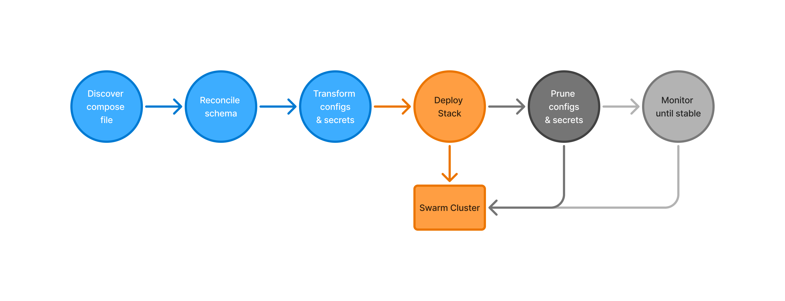

# Docker Swarm Deployments

[](https://github.com/matchory/docker-swarm-deployment-action/actions/workflows/linter.yml)
[](https://github.com/matchory/docker-swarm-deployment-action/actions/workflows/ci.yml)
[](https://github.com/matchory/docker-swarm-deployment-action/actions/workflows/check-dist.yml)
[](https://github.com/matchory/docker-swarm-deployment-action/actions/workflows/codeql-analysis.yml)
[](./badges/coverage.svg)

> A powerful GitHub Action to deploy your applications to a Docker Swarm
> cluster. It automatically reconciles features from the newer Compose
> Specification usually not available in Docker Swarm, rotates configs and
> secrets for you, and can optionally monitor stacks for any post-deployment
> issues (e.g., restart cycles or rollbacks) and let the deployment fail
> accordingly.  
> Designed to "do the right thing" out of the box, with flexible options for
> customization.



## 📑 Contents

- [✨ Features](#-features)
- [🚀 Getting Started](#-getting-started)
  - [Prerequisites](#prerequisites)
  - [Simple Usage](#simple-usage)
- [⚙ Configuration](#-configuration)
  - [Inputs](#inputs)
  - [Outputs](#outputs)
- [📖 Reference](#-reference)
  - [How Compose File Detection Works](#how-compose-file-detection-works)
    - [Using environment variables](#using-environment-variables)
    - [Specifying a Custom Compose File, or Multiple Files](#specifying-a-custom-compose-file-or-multiple-files)
  - [How Compose Files Are Processed](#how-compose-files-are-processed)
    - [Compose-Spec to Swarm Reconciliation](#compose-spec-to-swarm-reconciliation)
    - [Variable interpolation](#variable-interpolation)
  - [Configuring Secrets and Configs](#configuring-secrets-and-configs)
    - [Loading Environment Variables or inline Content](#loading-environment-variables-or-inline-content)
    - [Smart Variable Resolution](#smart-variable-resolution)
    - [Providing GitHub Secrets and Variables](#providing-github-secrets-and-variables)
    - [Automatic Rotation](#automatic-rotation)
    - [Configuring the Variable Name](#configuring-the-variable-name)
    - [Disabling Automatic Variable Management](#disabling-automatic-variable-management)
    - [Data Transformation](#data-transformation)
  - [How the stack is deployed](#how-the-stack-is-deployed)
  - [Configuring the Deployment in the Compose File](#configuring-the-deployment-in-the-compose-file)
    - [Stack Settings](#stack-settings)
    - [Service Labels](#service-labels)
    - [Deployment Labels](#deployment-labels)
  - [Removing a Stack](#removing-a-stack)
  - [Post-Deployment Monitoring](#post-deployment-monitoring)
    - [Monitoring Timeout & Interval](#monitoring-timeout--interval)
  - [Health Check Validation](#health-check-validation)
    - [Health Check Details in Failure Reports](#health-check-details-in-failure-reports)
- [🔨 Contributing](#-contributing)
  - [Development Setup](#development-setup)
  - [Before Opening a Pull Request](#before-opening-a-pull-request)
- [📄 License](#-license)

## ✨ Features

- **Easy Setup:** The action uses
  [the same environment variables](https://docs.docker.com/reference/cli/docker/#environment-variables)
  as the Docker CLI, so you can connect to your Docker Swarm cluster using a context, and via all transports supported
  by Docker (e.g., HTTP, TCP, SSH, etc.).
- **Smart Compose Handling:** It automatically discovers your Compose file and supports both the Compose Specification
  and Compose File v3, so you don't have to worry about incompatibilities.
- **Automatic Config & Secret Management:** It rotates secrets and configs automatically and can even transform their
  data on-the-fly (e.g., base64 encode/decode).
- **Reliable Deployments:** Validates your configuration before deploying using
  `docker stack config`.
- **Optional Post-Deployment Monitoring:** Ensures your services are stable after deployment.
- **Actionable Failure Diagnostics:** When a service fails, the action reports a categorized cause (image pull failure,
  crash, OOM kill, failing health check, scheduling problem, and more) along with the task attempt history and container
  logs — in the log output and the job summary alike, so you don't have to SSH into the cluster to find out what broke.
- **Fully Tested:** An extensive test suite ensures the action works as expected.

## 🚀 Getting Started

### Prerequisites

- A Docker Swarm cluster accessible in the GitHub Actions environment
- A Docker Compose file

### Simple Usage

In most cases, you don't need to explicitly tell the action where your Compose file is. If your file is named commonly
(like `compose.yaml`, `compose.yml`,
`docker-compose.yaml`, or `docker-compose.production.yml`) and is in your repository's root or a standard location, the
action will find it automatically.

Here's a basic workflow example:

```yaml
name: Deploy to Docker Swarm
on:
  push:
    branches:
      - main

jobs:
  deploy:
    runs-on: ubuntu-latest
    steps:
      - name: Checkout code
        uses: actions/checkout@v4

      - name: Deploy to Docker Swarm
        uses: matchory/docker-swarm-deployment-action@v1
        env:
          DOCKER_HOST: tcp://my-swarm-host:2375
```

You could also leverage a Docker context to connect to your Swarm cluster. This is the recommended way to connect to a
remote Docker host, as it allows you to use SSH or TLS for secure connections:

```yaml
name: Deploy to Docker Swarm
on:
  push:
    branches:
      - main

jobs:
  deploy:
    runs-on: ubuntu-latest
    steps:
      - name: Checkout code
        uses: actions/checkout@v4

      - uses: arwynfr/actions-docker-context@v2
        with:
          context_name: "swarm"
          docker_host: "ssh://someone@example.domain.tld"
          ssh_cert: ${{ secrets.SSH_CERT }}
          ssh_key: ${{ secrets.SSH_KEY }}

      - name: Deploy to Docker Swarm
        uses: matchory/docker-swarm-deployment-action@v1
        env:
          DOCKER_CONTEXT: swarm
```

The action talks to Docker exclusively through the `docker` CLI, so it honors whatever the CLI would use: the
`DOCKER_CONTEXT` and `DOCKER_HOST` environment variables, or the context selected with `docker context use` in an
earlier step. You can also create the context yourself, for example over SSH. Store the host's public key in
`SSH_KNOWN_HOSTS` (the `ssh-keyscan` output, verified out of band) rather than scanning it during the job, which would
trust whichever host answers:

```yaml
- name: Set up SSH
  env:
    SSH_KEY: ${{ secrets.SSH_KEY }}
    SSH_KNOWN_HOSTS: ${{ secrets.SSH_KNOWN_HOSTS }}
  run: |
    install -m 700 -d ~/.ssh
    printf '%s\n' "$SSH_KEY" > ~/.ssh/id_ed25519
    chmod 600 ~/.ssh/id_ed25519
    printf '%s\n' "$SSH_KNOWN_HOSTS" >> ~/.ssh/known_hosts

- name: Create Docker context
  run: |
    docker context create swarm --docker host=ssh://someone@example.domain.tld
    docker context use swarm

- name: Deploy to Docker Swarm
  uses: matchory/docker-swarm-deployment-action@v1
```

Set `DOCKER_CONTEXT`, `DOCKER_HOST`, `DOCKER_CONFIG`, `HOME`, `PATH`, and `SSH_AUTH_SOCK` in the step's `env`, not
through the `variables`, `secrets`, or `extra-variables` inputs: the action passes those inputs only to
`docker stack config` and `docker stack deploy`, so they would point just these two commands at a different daemon.
Listing them in `exclude-variables` is harmless, since every Docker command keeps the process environment.

## ⚙ Configuration

### Inputs

To configure the action, you can use the following inputs. Inputs marked with an asterisk (\*) can also be set in the
Compose file; see [Stack Settings](#stack-settings).

| Input                     | Default                               | Description                                                                                                                       |
|:--------------------------|:--------------------------------------|:----------------------------------------------------------------------------------------------------------------------------------|
| `stack-name`              | _Repository name_                     | The name of the stack to deploy. If not specified, the repository name (without the "user/" part) will be used.                   |
| `version`                 | _Tag Name&thinsp;/&thinsp;Commit SHA_ | The version of the stack to deploy. If not specified, the action will use the tag name or commit SHA of the build.                |
| `compose-file`            | _—_                                   | The path to the compose file. If not specified, the action will [automatically search for it](#how-compose-file-detection-works). |
| `env-var-prefix`\*        | `DEPLOYMENT`                          | Prefix to resolve variables intended for [auto-configuration of variables](#smart-variable-resolution). Trailing `_` stripped.    |
| `manage-variables`\*      | `true`                                | Whether to automatically [manage configs and secrets](#configuring-secrets-and-configs).                                          |
| `strict-variables`\*      | `true`                                | Whether to fail if a `file` secret/config source is unreadable, instead of [falling back](#smart-variable-resolution).            |
| `strict-compatibility`\*  | `false`                               | Whether to fail on Swarm-incompatible features. See [reconciliation](#compose-spec-to-swarm-reconciliation).                      |
| `key-interpolation`\*     | `false`                               | Whether to interpolate variables in Compose Spec _keys_ too, not just values. See [interpolation](#variable-interpolation).       |
| `variables`               | _—_                                   | Variables as KEY=value pairs, newline-separated, or JSON object (e.g., `${{ toJSON(vars) }}`). Applies to environment.            |
| `secrets`                 | _—_                                   | Secrets as KEY=value pairs, newline-separated, or JSON object (e.g., `${{ toJSON(secrets) }}`). Higher priority than variables.   |
| `exclude-variables`       | _—_                                   | List of variable names to exclude from deployment, separated by newlines. Applies to every source except `extra-variables`.       |
| `extra-variables`         | _—_                                   | Additional variables as KEY=value pairs, separated by newlines. Highest priority, overrides all other sources.                    |
| `monitor`\*               | `false`                               | Whether to [monitor the stack](#post-deployment-monitoring) after deployment.                                                     |
| `monitor-timeout`\*       | `300`                                 | The maximum time in seconds to wait for the stack to stabilize.                                                                   |
| `monitor-interval`\*      | `5`                                   | The interval in seconds to check the stack status.                                                                                |
| `health-check-warnings`\* | `true`                                | Whether to emit [warnings for missing or suspect health checks](#health-check-validation).                                        |
| `destroy`                 | `false`                               | Whether to [remove the stack](#removing-a-stack) instead of deploying it.                                                         |
| `upload-compose-spec`     | `true`                                | Whether to upload the final compose spec as a workflow artifact. It may contain interpolated variable values.                     |

### Outputs

| Output         | Description                                                          |
|:---------------|:---------------------------------------------------------------------|
| `status`       | The status of the deployment. Possible values: `success`, `failure`. |
| `stack-name`   | The name of the stack that was deployed.                             |
| `version`      | The version of the stack that was deployed.                          |
| `compose-spec` | The final compose specification used for the deployment.             |
| `service-logs` | Logs of a failed service after deployment.                           |

> **Note:** The `compose-spec` output is the _interpolated_ specification, so it
> contains the resolved value of every variable it references, including any
> supplied through the `secrets` input. It is **not** redacted: treat it as
> sensitive, and do not write it anywhere you would not write a secret. The
> uploaded artifact is different — `secrets` values are redacted there, and the
> upload can be turned off entirely with `upload-compose-spec`.

## 📖 Reference

### How Compose File Detection Works

If the `compose-file` input is not specified, the action automatically searches for your Compose File(s) in the
following common locations and names, in descending order:

1. `compose.production.yaml`
2. `compose.production.yml`
3. `compose.prod.yaml`
4. `compose.prod.yml`
5. `compose.yaml`
6. `compose.yml`
7. `docker-compose.production.yaml`
8. `docker-compose.production.yml`
9. `docker-compose.prod.yaml`
10. `docker-compose.prod.yml`
11. `docker-compose.yaml`
12. `docker-compose.yml`
13. `.docker/compose.yaml`
14. `.docker/compose.yml`
15. `.docker/docker-compose.yaml`
16. `.docker/docker-compose.yml`
17. `docker/compose.yaml`
18. `docker/compose.yml`
19. `docker/docker-compose.yaml`
20. `docker/docker-compose.yml`

The first file found will be used. Modern `compose.*` files take priority over legacy `docker-compose.*` files,
following the
[Compose Specification](https://www.compose-spec.io/) standardized in 2021. This covers most standard project structures
while maintaining full backward compatibility.

#### Using environment variables

The action also respects the `COMPOSE_FILE` environment variable if set, and multiple files specified there or via the
`compose-file` input can be separated by the `COMPOSE_PATH_SEPARATOR` environment variable (defaults to `:`). If the
value contains newlines and `COMPOSE_PATH_SEPARATOR` is not set, newlines are used as the separator instead.

#### Specifying a Custom Compose File, or Multiple Files

If your Compose File doesn't follow the automatic detection pattern, or you need to use multiple Compose Files (which
will be merged), use the compose-file input:

```yaml
- name: Deploy with Custom Compose File
  uses: matchory/docker-swarm-deployment-action@v1
  with:
    stack-name: my-application
    compose-file: path/to/your/custom-compose.yaml
```

To use multiple files, separate them with newlines:

```yaml
- name: Deploy with Multiple Compose Files
  uses: matchory/docker-swarm-deployment-action@v1
  with:
    stack-name: my-application
    compose-file: |
      compose.yaml
      compose.override.yaml
```

At least one of the files must define a service; the others can contribute just shared configs, secrets, networks
or volumes.

You can also use a custom delimiter (defaults to `:`) by setting the
`COMPOSE_PATH_SEPARATOR` environment variable.

### How Compose Files Are Processed

The action is designed to be flexible and robust when it comes to your Compose files. It doesn't strictly require either
the old v3 format or the new Compose Specification. Instead, it:

- Reads your specified (or detected) Compose File(s).
- Applies internal transformations to handle known differences between formats for Swarm compatibility.
- Uses `docker stack config` to validate the resulting configuration and merge multiple files into a single, canonical
  Compose Specification.

This ensures that regardless of the exact format you use (even mixing them), the final configuration passed to
`docker stack deploy` is valid and correctly interpreted by Docker Swarm.

A Compose file without a `version` key, as the Compose Specification recommends, is validated against stack file version
`3.12`, so recent fields like `healthcheck.start_interval` are accepted. This requires Docker 25 or later on the runner;
with an older version, set an explicit `version` in your Compose file. If you deploy several Compose files and another
of them sets a `version`, a file without one uses that version instead, since Docker rejects files whose versions differ.

#### Compose-Spec to Swarm Reconciliation

Modern Compose Specification constructs (like `develop`, `gpus`, or `label_file`) aren't understood by
`docker stack config`, which hard-fails the moment it sees them. Before validation, the action reconciles your Compose
Spec into a form Swarm understands: supported shorthands are translated automatically, unsupported features are stripped
with a warning, and unknown or misspelled keys are flagged with a "did you mean?" hint.

Set `strict-compatibility: true` to fail the deploy when a feature had to be **stripped** (e.g. `develop`, `profiles`,
`provider`) or a translation **conflicted** with an existing `deploy.*` value. Kept-but-ignored keys (`build`,
`container_name`) and heuristic unknown-key hints stay advisory and never fail the build — `docker
stack config` remains the authoritative validator.

Translated resource (`mem_limit`, `mem_reservation`, `cpus`) and `restart` values are non-clobbering: if the equivalent
`deploy.*` value is already set explicitly, it always wins over the shorthand.
`label_file` paths resolve relative to the compose file's own directory and are confined to the workspace; an unreadable
file is warned about, not fatal.

| Compose key                   | Handling                             | Swarm result                                                                                                                                  |
|-------------------------------|--------------------------------------|-----------------------------------------------------------------------------------------------------------------------------------------------|
| `mem_limit`                   | Translated                           | `deploy.resources.limits.memory`                                                                                                              |
| `mem_reservation`             | Translated                           | `deploy.resources.reservations.memory`                                                                                                        |
| `cpus`                        | Translated                           | `deploy.resources.limits.cpus`                                                                                                                |
| `restart`                     | Translated                           | `deploy.restart_policy` (`no`→`none`, `always`/`unless-stopped`→`any`, `on-failure`→`on-failure`; `on-failure:N` also sets `max_attempts: N`) |
| `depends_on` (map/conditions) | Translated                           | converted to list form; conditions dropped (swarm has no ordering)                                                                            |
| `label_file`                  | Translated                           | contents merged into `labels` (explicit labels win)                                                                                           |
| `container_name`              | Kept + warned                        | ignored by swarm (tasks are named automatically)                                                                                              |
| `build`                       | Kept + warned                        | ignored by swarm (provide a pre-built `image`)                                                                                                |
| `develop`                     | Stripped + warned                    | no swarm equivalent (dev-only watch config)                                                                                                   |
| `post_start` / `pre_stop`     | Stripped + warned                    | lifecycle hooks unsupported by swarm                                                                                                          |
| `profiles`                    | Stripped + warned                    | unsupported; all services are always deployed                                                                                                 |
| `memswap_limit`               | Stripped + warned                    | no swarm swap-limit control                                                                                                                   |
| `gpus`                        | Stripped + warned                    | use `deploy.resources.reservations.generic_resources` + node labels                                                                           |
| `provider`                    | Service dropped + warned             | provider services cannot run on swarm                                                                                                         |
| `models` (top-level)          | Stripped + warned                    | model runner unsupported by swarm                                                                                                             |
| Unknown/misspelled keys       | Warned (with a "did you mean?" hint) | left untouched; may still fail `docker stack config`                                                                                          |

##### `!reset` / `!override` merge tags

Compose files may use the standard `!reset` and `!override` merge tags to
control how base and override files combine. When present, the action
merges the files with `docker compose config` (which honors the tags),
then reconciles the tag-free merged result for Swarm — so these tags work
even on keys the action rewrites (`restart`, `mem_limit`, `depends_on`,
`label_file`, and `deploy`). Only the secret/config `content:` transform
runs before the merge. This requires the Docker Compose v2 plugin on the
runner (included on GitHub-hosted runners); if it is missing and these
tags are used, the action fails with a clear error rather than merging
incorrectly.

#### Variable interpolation

All environment variables inside the Compose Spec(s) will be interpolated automatically according to the
[Compose Specification rules](https://docs.docker.com/reference/compose-file/interpolation/), with one optional
improvement: If you enable the `key-interpolation` input, the action will also replace environment variables in all keys
in your Compose Spec, not just in values. This is useful for dynamic service names or other keys that depend on
environment variables. If two keys in the same mapping interpolate to the same name, the deployment fails with an error
naming that key.

The following syntax is supported for variable interpolation:

```yaml
- "$VARIABLE_NAME"
- "${VARIABLE_NAME}"
- "${VARIABLE_NAME-default if not set}"
- "${VARIABLE_NAME:-default if not set or empty}"
- "${VARIABLE_NAME+alternative if set}"
- "${VARIABLE_NAME:+alternative if set and not empty}"
- "${VARIABLE_NAME?error if not set}"
- "${VARIABLE_NAME:?error if not set or empty}"
```

In contrast to the legacy Compose File v3 format, the Compose Specification (and the implementation in this action) do
allow for unlimited nesting in default and alternative values, meaning that the following will work as expected:

```yaml
- "${FOO:-${BAR:-${BAZ}}}"
```

As in Compose, variable _values_ are inserted literally and never interpolated again: if `DB_PASSWORD` is `p@$$w0rd`,
`${DB_PASSWORD}` becomes `p@$$w0rd`, and a value of `$OTHER` stays `$OTHER`. To get a literal `$` in the Compose file
itself, escape it as `$$`. A `$` followed by anything other than `$`, `{` or a variable name is kept as it is.

As Compose does, a `${` that does not start a valid reference, such as `${FOO.bar}` or an unterminated
`${FOO:-bar`, fails the deployment with an `Invalid interpolation format` error naming the reference and where it is.

Also as in Compose, a variable that is used without a default value but is not set is replaced with an empty string, and
the action logs a warning such as `The "VERSION" variable is not set. Defaulting to a blank string.`, once per variable.
The same applies to the `content` of secrets and configs, with one warning per variable and secret or config. Use
`${VERSION:?message}` to fail instead.

Files listed in a service's `env_file` are read by the action and merged into its `environment` following the Compose
rules, so they behave as with `docker compose`:

- Unquoted and double-quoted values are interpolated: `A=$B` and `A="$B"` get the value of `B`, and `$$` becomes `$`.
  Variables are looked up in the action's variables first, then in the service's `environment`, then in the keys set
  earlier in the env files.
- Single-quoted values are literal: `A='$B'` is `$B`. The quotes are not part of the value.
- Double-quoted values may span lines and expand escapes such as `\n`, `\t`, `\"` and `\\`.
- `#` starts a comment at the start of a line, or after a space in an unquoted value. An `export` prefix is ignored.
- A line with only a key (`A`) takes its value from the action's variables or the service's `environment`, and is left
  out if neither has it.
- Entries in `environment` win over env files, in any Compose file, and later env files win over earlier ones.
- The long syntax (`- path: optional.env` with `required: false`) skips a file that does not exist. Its `format`
  attribute is not supported.

Relative `env_file` paths resolve against the working directory, like relative `file:` sources of configs and secrets.

In addition to all variables in the process environment and those
[passed in the `variables` input](#providing-github-secrets-and-variables), the following variables derived from the
inputs are also available:

- `MATCHORY_DEPLOYMENT_STACK`: The name of the stack being deployed.
- `MATCHORY_DEPLOYMENT_VERSION`: The version of the stack being deployed.

### Configuring Secrets and Configs

#### Loading Environment Variables or inline Content

Docker Swarm only supports reading configs and secrets from files, but the Compose Specification allows you to use the
[`environment`](https://docs.docker.com/reference/compose-file/secrets/#example-2)
and
[`content`](https://docs.docker.com/reference/compose-file/configs/#example-2)
properties to load them from environment variables or inline content, respectively. This action automatically converts
these properties to files, so you can use them in your Compose File without worrying about the deployment.

For example, if you have a Compose File with the following configs:

```yaml
configs:
  app_url:
    environment: APP_URL
  database_username:
    content: root
```

The action will automatically create files for these configs, and the resulting specification file passed to the actual
`docker stack deploy` call will look like this:

```yaml
configs:
  app_url:
    file: /home/runner/work/app/app/app_url.1740e753-0a19-446a-ba6e-361b24f5d9e1.generated.secret
    # omitting rest for brevity
  database_username:
    file: /home/runner/work/app/app/database_username.c95397dc-c300-4125-b95e-e2ce43821d72.generated.secret
    # omitting rest for brevity
```

The action will create the files in the working directory, readable only by the runner user, and append a unique
identifier to the filename to avoid conflicts. The files are removed once the deployment no longer needs them —
including when the deployment fails — so no plain variable values are left behind for a later job to read.

#### Smart Variable Resolution

You don't have to specify the data source (`file`, `environment`, or `content`)
manually: In fact, you don't have to add any properties at all! The following example will work just as well:

```yaml
configs:
  # Pass an empty object, …
  app_url: { }

  # …or even a YAML-null value for brevity!
  database_username: ~
```

The action will attempt to resolve the variable content automatically, and populate the `file` property with that. The
prefix used below is the `env-var-prefix` input (`DEPLOYMENT` by default); a trailing underscore is stripped from it, and
it is joined to the variable name with a single `_`. Resolution follows these rules:

1. If a file named after the variable key with the suffix `.secret` exists in the working directory (e.g.
   `./app_url.secret`), it will be used as the file source.
2. If an environment variable with one of the following name patterns exists, it will be used as the environment source:

    - Exact variable key (e.g. `app_url`)
    - Uppercase variable key (e.g. `APP_URL`)
    - Variable key prefixed with the [`envVarPrefix`](#inputs) (e.g.
      `DEPLOYMENT_app_url`)
    - Uppercase variable key prefixed with the [env var prefix setting](#inputs)
      (e.g. `DEPLOYMENT_APP_URL`)
    - Variable key prefixed with the [stack name](#inputs) (e.g.
      `my_repo_app_url`)
    - Uppercase variable key prefixed with the [stack name](#inputs) (e.g.
      `MY_REPO_APP_URL`)
3. If neither of the above is found, an error will be thrown and the action will fail.

#### Providing GitHub Secrets and Variables

You can use GitHub Secrets and Variables to provide the values for your configs. This action supports multiple ways to
pass variables, making it easy to work with both individual variables and bulk repository configuration.

##### Using JSON input (Recommended)

The easiest way to pass all repository secrets and variables is using JSON input. This approach eliminates the need to
list each variable individually:

```yaml
- name: Deploy to Docker Swarm
  uses: matchory/docker-swarm-deployment-action@v1
  with:
    stack-name: my-application
    # Pass all repository variables as JSON
    variables: ${{ toJSON(vars) }}
    # Pass all repository secrets as JSON
    secrets: ${{ toJSON(secrets) }}
    # Optionally exclude specific variables
    exclude-variables: |
      SOME_INTERNAL_VAR
      CI_TOKEN
    # Add extra runtime variables if needed
    extra-variables: |
      DEPLOYMENT_ID=${{ github.run_id }}
      BUILD_URL=${{ github.repository }}/actions/runs/${{ github.run_id }}
```

##### Using key-value pairs

You can also use the traditional approach with explicit key-value pairs. This gives you fine-grained control over which
variables to include:

```yaml
- name: Deploy to Docker Swarm
  uses: matchory/docker-swarm-deployment-action@v1
  with:
    stack-name: my-application
    variables: |
      # Lines starting with '#' are ignored as comments
      APP_URL=https://myapp.example.com
      DATABASE_USERNAME=${{ vars.DATABASE_USERNAME }}
      DATABASE_PASSWORD=${{ secrets.DATABASE_PASSWORD }}
```

Each line is split at its first `=`: the name is trimmed, and the value is kept exactly as written, including any further
`=` and surrounding whitespace.

##### Variable priority and merging

When using multiple input sources, variables are merged with the following priority (later sources override earlier
ones):

1. **Environment variables** (lowest priority)
2. **`variables` input** (JSON or key-value)
3. **`secrets` input** (JSON or key-value)
4. **`extra-variables` input** (highest priority)

The `exclude-variables` filter is applied after the environment, `variables`, and `secrets` sources have been merged,
but **before** `extra-variables`. Variables passed via `extra-variables` therefore cannot be excluded.

##### Setting multi-line variables

Multi-line variables (e.g., PEM keys or certificates) are supported in key-value inputs using HEREDOC syntax [similar to
`$GITHUB_ENV`](https://docs.github.com/en/actions/reference/workflows-and-actions/workflow-commands#multiline-strings):

```yaml
variables: |
  APP_URL=https://myapp.example.com
  NODE_LIST<<EOF
  node-1.example.com
  node-2.example.com
  node-3.example.com
  EOF
  DATABASE_USERNAME=${{ vars.DATABASE_USERNAME }}
```

##### Mixed usage examples

You can mix JSON and key-value formats as needed:

```yaml
# Example: Use JSON for bulk config, key-value for specific overrides
- name: Deploy to Docker Swarm
  uses: matchory/docker-swarm-deployment-action@v1
  with:
    variables: ${{ toJSON(vars) }}           # All repository variables
    secrets: ${{ toJSON(secrets) }}          # All repository secrets  
    extra-variables: |                       # Runtime-specific variables
      DEPLOYMENT_TIME=${{ github.event.head_commit.timestamp }}
      GIT_SHA=${{ github.sha }}
    exclude-variables: |                     # Remove sensitive CI variables
      GITHUB_TOKEN
      RUNNER_TOKEN
```

#### Automatic Rotation

A major pain point deploying applications to Docker Swarm is managing secrets and configs (henceforth called _"
variables"_), which are designed to be immutable and cannot be updated in place. This action automates the process of
creating new variables when deploying and updating the stack to use them.  
To make this work, the action detects changes to the _content_ of variables referenced in the Compose File by storing
their SHA256 hash in a label on the variable and appending it to the full name. For example, given the following config
in the Compose File:

```yaml
configs:
  database_username:
    content: root
```

The action will transform it to:

```yaml
configs:
  database_username:
    name: YOUR_STACK-database_username-4813494
    file: /home/runner/work/app/app/database_username.36934723-0a0b-4eb6-ab9d-d3a4e5e3cb34.generated.secret
    labels:
      com.matchory.deployment.name: database_username
      com.matchory.deployment.hash: 4813494d137e1631bba301d5acab6e7bb7aa74ce1185d456565ef51d737677b2
      com.matchory.deployment.stack: YOUR_STACK
      com.matchory.deployment.version: VERSION
```

_(`YOUR_STACK` and `VERSION` are placeholders for the actual stack name and version as defined in the settings)_

This has two notable implications:

1. As the short SHA256 hash is appended to the variable name, it will stay stable if the content doesn't change across
   deployments, which avoids unnecessary updates to the stack. If the database username stays root, the stack will
   continue to use the variable created in the initial deployment, even if other variables or settings are updated.
2. After the deployment is complete, the action will prune any unused variables by checking the labels. If a variable is
   not referenced in the Compose File anymore, it will be safely removed from the cluster. This is important to keep the
   cluster clean and avoid cluttering it with old variables. Variables referenced by the previous spec of one of the
   stack's services are kept, so a rollback (automatic or via `docker service rollback`) can still find them; all other
   versions are removed. Only this stack's services are checked: if another stack uses one of these variables through
   `external`, Swarm still refuses to remove it while that stack's current spec references it, but not for its previous
   spec.

#### Configuring the Variable Name

The deployment action will automatically construct the variable name from the following template:

```typescript
`${stackName}-${variableName}-${hash.slice(0, 7)}`;
```

As the name must be globally unique, this includes the stack name, the name of the variable (the key in the Compose
File), and the first seven characters of the hash. This ensures that even if two stacks use the same variable name, they
will not conflict.  
If you provide a custom name for the variable, it will be used verbatim, but **the hash will still be appended**. This
is necessary to enable automatic change detection and pruning.

#### Disabling Automatic Variable Management

If you want to manage your variables manually, you can either disable the automatic variable management altogether by
setting the `manage-variables` input to `false`, or you can add the `com.matchory.deployment.ignore` label to the
variable:

```yaml
configs:
  dotenv:
    file: .env
    labels:
      com.matchory.deployment.ignore: "true"
```

This will prevent the action from touching the variable, and it will not be pruned after the deployment. Note that this
will also disable the automatic conversion of compose-spec-style inputs from `content` or `environment`.

#### Data Transformation

You can optionally transform the data of your configs and secrets during the deployment process using labels in your
Compose File. This is useful for handling sensitive data that might be stored in an encoded format.  
Add either the `com.matchory.deployment.encode` or
`com.matchory.deployment.decode` label to your config or secret definition, specifying one of the supported formats:

- `base64`
- `base64url`
- `hex`
- `url`

For example, to load a base64-encoded environment variable:

```yaml
configs:
  my_config:
    environment: BASE64_ENCODED_PEM_KEY
    labels:
      com.matchory.deployment.decode: "base64"
```

This will decode the variable before passing it to the container, resulting in a properly formatted, multi-line PEM key
in the container file system.

Do you have a different encoding in mind? Feel free to open an issue or PR, and we can add it to the action.

### How the stack is deployed

To deploy the final specification, the action uses the `docker stack deploy`
command effectively like this:

```shell
echo $final_spec | docker stack deploy \
     --resolve-image=always \
     --with-registry-auth \
     --compose-file "-" \
     --detach=true \
     --quiet \
     --prune \
  $stack_name
```

### Configuring the Deployment in the Compose File

Besides the action inputs, the deployment can be configured in the Compose file itself: settings for the whole stack in
a top-level `x-matchory-deployment` block, and settings for single services as labels. Settings kept in the file travel
with it, so every workflow and environment deploying the file deploys it the same way.

#### Stack Settings

The following inputs can also be set in a top-level `x-matchory-deployment` block: `env-var-prefix`,
`manage-variables`, `strict-variables`, `strict-compatibility`, `key-interpolation`, `monitor`, `monitor-timeout`,
`monitor-interval`, and `health-check-warnings`.

```yaml
x-matchory-deployment:
  monitor: true
  monitor-timeout: 600
  key-interpolation: true

services:
  app:
    image: my-app:latest
```

An input set in the workflow wins over the Compose file, which wins over the default. This lets a single workflow
override a setting for one environment without editing the file. Settings that choose _what_ to deploy, such as
`stack-name`, `compose-file`, or `version`, are inputs only.

The block is read from the files as written, before anything else, because its settings govern how the files are
loaded. Its values are therefore not interpolated. When deploying multiple Compose files, a later file's settings win
over an earlier file's. Invalid values fail the deployment, even if an input overrides them; unknown settings are
ignored with a warning.

#### Service Labels

Some settings can be changed for a single service, using labels in its `deploy.labels`. A service label wins over the
stack-wide setting, wherever that comes from:

| Label                                           | Overrides               | Values                     |
|:------------------------------------------------|:------------------------|:---------------------------|
| `com.matchory.deployment.monitor`               | `monitor`               | `true` or `false`          |
| `com.matchory.deployment.monitor-timeout`       | `monitor-timeout`       | Whole number of seconds    |
| `com.matchory.deployment.health-check-warnings` | `health-check-warnings` | `true` or `false`          |

```yaml
services:
  app:
    image: my-app:latest
    deploy:
      labels:
        # Takes a while to warm up
        com.matchory.deployment.monitor-timeout: "900"

  migrate:
    image: my-app:latest
    command: ["migrate"]
    deploy:
      restart_policy:
        condition: none
      labels:
        # Exits once done, so there is nothing to wait for
        com.matchory.deployment.monitor: "false"
        com.matchory.deployment.health-check-warnings: "false"
```

Monitoring runs if any service is monitored, so a label can also enable it for one service while it is disabled for
the stack. Labels are read after [interpolation](#variable-interpolation), so their values may use variables. They are
validated before the stack is deployed, and an invalid value fails the deployment without deploying anything. Labels on
the container (`labels`) rather than the service (`deploy.labels`) are not read.

#### Deployment Labels

The action adds the following labels to the `deploy.labels` of every service, so you can tell which build is running
from `docker service inspect` or any tool that shows service labels:

| Label                             | Value                                                    |
|:----------------------------------|:---------------------------------------------------------|
| `com.matchory.deployment.version` | The deployed [version](#inputs)                          |
| `com.matchory.deployment.commit`  | The full commit SHA (`GITHUB_SHA`)                       |
| `com.matchory.deployment.ref`     | The branch or tag that triggered the workflow            |
| `com.matchory.deployment.run-url` | The URL of the workflow run that deployed the service    |
| `com.matchory.deployment.actor`   | The user that triggered the workflow run                 |

Labels whose value the runner does not provide are left out. They replace labels of the same name in the Compose file.

Since they are service labels, not container labels, a new commit does not restart a service: Swarm updates the
service's metadata in place and only rolls out new tasks for changes to the containers themselves.

### Removing a Stack

Setting the `destroy` input removes the stack instead of deploying it, for example to tear down a preview environment
when its pull request is closed:

```yaml
on:
  pull_request:
    types: [closed]

jobs:
  teardown:
    runs-on: ubuntu-latest
    steps:
      - name: Remove the preview stack
        uses: matchory/docker-swarm-deployment-action@v1
        with:
          stack-name: preview-${{ github.event.number }}
          destroy: true
```

The `stack-name` input is required here: the default, the repository name, is usually the name of the main stack, so
a teardown job that forgot to name its preview stack would otherwise remove that.

This runs `docker stack rm` and waits until the stack's services, networks, configs, and secrets are gone. Volumes are
kept, so their data survives. No Compose file is read, so the job does not need to check out the repository. A stack
that does not exist is not an error, so a teardown can safely run more than once.

To guard against a mistyped stack name, the action only removes a stack it deployed: one of its services must carry the
[deployment labels](#deployment-labels), or one of its configs or secrets must be managed by the action for this stack.
Otherwise, the action fails without removing anything.

### Post-Deployment Monitoring

The action can optionally monitor your stacks for any post-deployment issues (e.g., restart cycles or rollbacks) and
fail the deployment accordingly. This is done by checking the status of the services in the stack after the deployment,
waiting until all services are running and stable.  
Especially for bigger deployments, this can take a while, so the monitoring feature is disabled by default. You can
enable it by setting the `monitor` input to `true`.

**Note that a monitoring failure will _not_ automatically roll back the stack.**
Swarm takes care of that itself. Stack Monitoring solves a different problem: It makes sure an update to a stack is not
only successful, but also stable, that is, it doesn't roll back or restart any services after the deployment. If that
happens, and the stack does not stabilize, monitoring will fail the action and notify you of the issue.

#### Monitoring Timeout & Interval

The action will wait for a configurable maximum of `monitor-timeout` seconds for the services to stabilize, checking
their status every `monitor-interval`
seconds. The default values are 5 minutes and 5 seconds, respectively.

You can adjust these values to suit your needs. For example, if you want to wait for 10 minutes and check every 30
seconds, you can set the following inputs:

```yaml
jobs:
  deploy:
    runs-on: ubuntu-latest
    steps:
      - name: Deploy to Docker Swarm
        uses: matchory/docker-swarm-deployment-action@v1
        with:
          monitor: true
          monitor-timeout: 600 # 10 minutes
          monitor-interval: 30 # 30 seconds
```

To give a single slow service more time, or to leave it out of monitoring, use a
[service label](#service-labels). Each service is held to its own timeout.

### Health Check Validation

The action validates health check configurations in your compose spec before deploying, emitting warnings for common
issues. This helps catch misconfigurations early rather than debugging failing containers post-deployment.

**Missing health checks:** A warning is emitted for any service that has no
`healthcheck` defined, or has it explicitly disabled (`test: ["NONE"]` or
`disable: true`).

**Suspect configurations:** The action warns about:

- **interval < timeout** — the health check will overlap with itself
- **retries: 1** — a single failure marks the container unhealthy
- **No start_period with short interval (< 10s)** — the container may fail checks before it is ready

To suppress these warnings, set `health-check-warnings` to `false`:

```yaml
- name: Deploy to Docker Swarm
  uses: matchory/docker-swarm-deployment-action@v1
  with:
    health-check-warnings: false
```

To suppress them for a single service only, use the `com.matchory.deployment.health-check-warnings`
[service label](#service-labels).

#### Health Check Details in Failure Reports

When monitoring is enabled and a service fails due to a health check issue, the failure report includes the health check
configuration (test command, interval, timeout, retries, start period) alongside the task history and container logs.
This appears in both the action log output and the GitHub Actions job summary.

## 🔨 Contributing

Contributions are welcome! If you have any ideas, suggestions, or bug reports, please open an issue or a pull request.

### Development Setup

The action is written in TypeScript and runs on Node 24. After cloning, install the dependencies:

```shell
npm install
```

The following scripts are available:

| Task                  | Command                |
|:----------------------|:-----------------------|
| Run the full pipeline | `npm run all`          |
| Run the tests         | `npm run test`         |
| Type-check            | `npm run typecheck`    |
| Lint                  | `npm run lint`         |
| Check formatting      | `npm run format:check` |
| Fix formatting        | `npm run format:write` |
| Bundle the action     | `npm run package`      |

Linting and formatting are handled by [Biome](https://biomejs.dev/), and the tests run on
[Vitest](https://vitest.dev/).

### Before Opening a Pull Request

Two things are easy to miss:

- **The `dist/` directory is committed.** [esbuild](https://esbuild.github.io) bundles the TypeScript sources
  into a single file that the Actions runner executes, so `npm run package` has to run after any change under `src/`.
  A dedicated CI workflow fails the build if `dist/` is out of date.
- **`npm run all` should pass locally.** It chains formatting, linting, type-checking, tests, the coverage badge, and
  the bundle — the same steps CI runs.

If you changed dependencies, run `npm install` so `package-lock.json` stays in sync; `npm ci` fails otherwise.

## 📄 License

Released under the [MIT License](./LICENSE).
